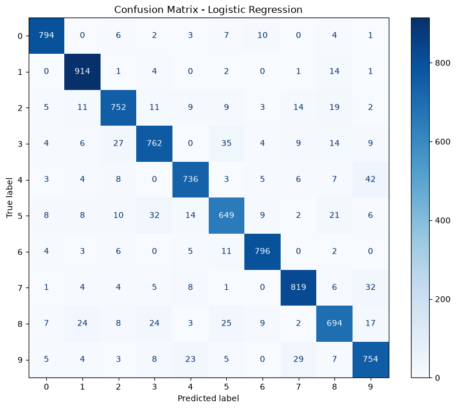
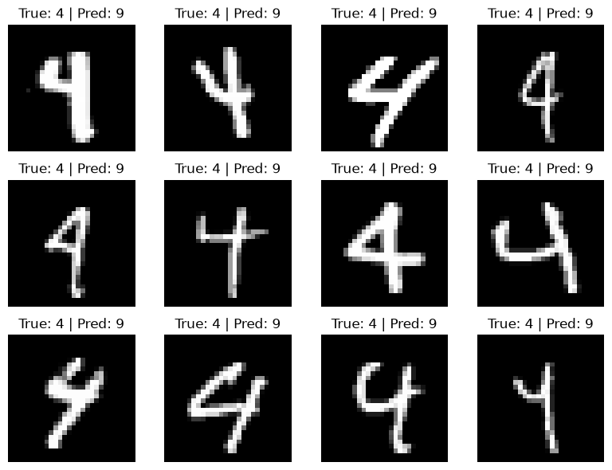
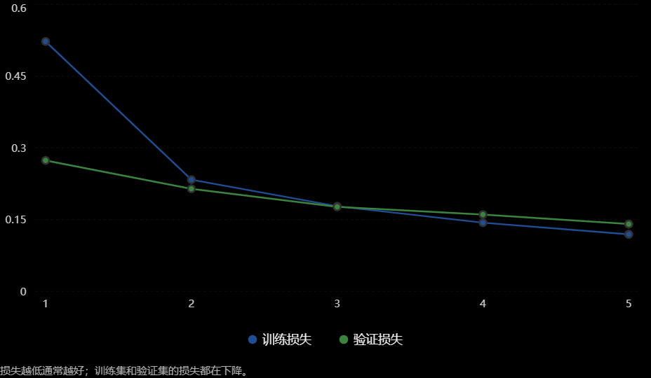
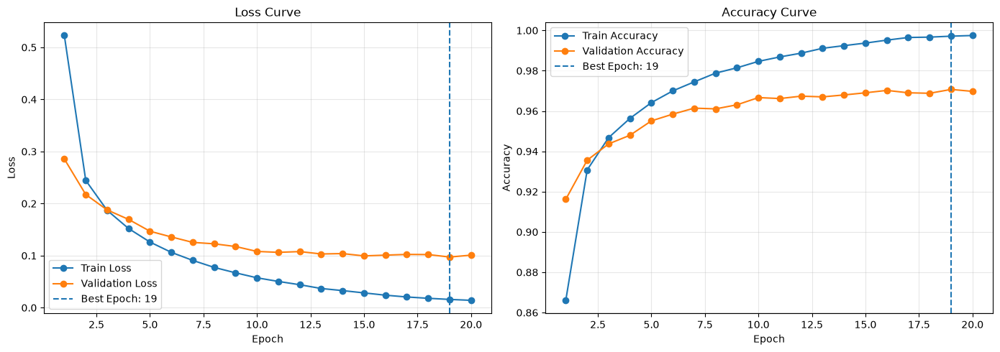
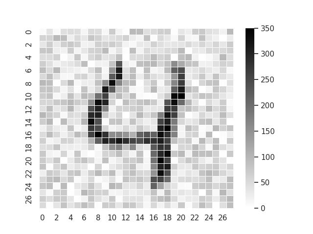
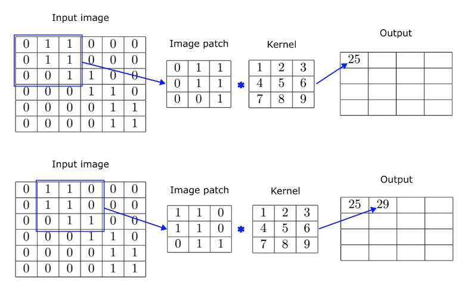
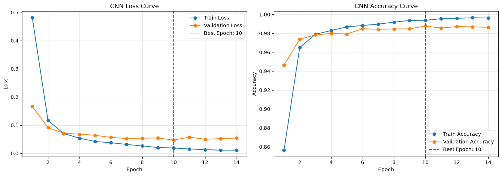

# Digit Recognizer

## Development Environment

VS Code + Python 虚拟环境 + Jupyter + PyTorch

python --version:Python 3.14.3
pip --version:pip 26.2.1 from C:\Users\1\AppData\Roaming\Python\Python314\site-packages\pip (python 3.14)

nvidia-smi

GPU： NVIDIA GeForce RTX 3050 Laptop GPU

驱动版本： 617.42

CUDA UMD Version： 13.4

显存： 4GB

PyTorch：2.14.1+cu126


## 一些快捷命令

```
cd D:\Code\digit-recognizer
```

激活项目虚拟环境

```
.\.venv\Scripts\Activate.ps1
```

## 数据分析工具

这些库分别用于：

| 工具         | 用途                           |
| ------------ | ------------------------------ |
| NumPy        | 数组与数值计算                 |
| Pandas       | 读取 Kaggle 的 CSV 数据        |
| Matplotlib   | 显示手写数字图片、绘制训练曲线 |
| Scikit-learn | 划分训练集和验证集             |
| Jupyter      | 交互式编写、运行代码           |
| ipykernel    | 让 Jupyter 使用当前虚拟环境    |

## 数据集划分


| 三种数据集            | 作用                                   |
| :-------------------- | -------------------------------------- |
| 训练集 Training Set   | 用来更新模型参数，让模型学习。         |
| 验证集 Validation Set | 用来检查模型的泛化能力，辅助选择模型。 |
| 测试集 Test Set       | 用于最终评估模型在未见数据上的表现。   |

| 数据               | 形状        |
| ------------------ | ----------- |
| Kaggle `train.csv` | 42000 × 785 |
| Kaggle `test.csv`  | 28000 × 784 |

对Kaggle `train.csv`中的42,000 张手写数字图片，采用 80% 训练集 + 20% 验证集

- 训练集：33,600 张。
- 验证集：8,400 张。

## 逻辑回归（Logistic Regression）模型

```
训练准确率：95.5863%
验证准确率：89.6071%
```

模型难以收敛：进行**归一化**，把像素值从 0～255 缩放到 0～1

采用归一化后：

```
训练准确率：94.5655%
验证准确率：91.3095%
实际迭代次数： 232
```

我们更关心模型在未参与训练的数据上的表现

## 混淆矩阵（Confusion Matrix）

## 看看模型到底错在哪里

准确率告诉我们模型预测对了多少，却没有告诉我们：

- 哪些数字最容易被识别错？
- 数字 4 会不会经常被识别成 9？
- 数字 3 会不会经常被识别成 5？
- 哪些数字的识别效果特别好？



把模型预测错误的数字 4 详细查看



## 用 PyTorch 从零搭建第一个MLP神经网络

第一步：把 Pandas 数据转换为 PyTorch 张量

第二步：创建 DataLoader

第三步：搭建第一个神经网络

第四步：**配置损失函数和优化器**




.png)

20轮训练指标记录、可视化、最佳模型保存、早停（Early Stopping）和验证集评估。



### MLP 的局限



MLP 接收一张图片时，会把它展平成 784 个数字

28 × 28 → 784 个数字

例如：[0, 0, 0, 12, 180, 255, …]

MLP 全连接层

学习 784 个像素与数字类别之间的关系

展平操作本身虽然没有丢失像素值，却不再显式保留图片的二维排列结构。

例如，数字 4 的斜线、横线和竖线之间存在空间关系。MLP 可以学习这些关系，但它没有专门利用图像的局部结构，参数量也可能比较大。

CNN 的思路不同：不急着把图片展平，而是先在二维图像上提取特征。


## CNN

### 卷积核

想象你拿着一个小窗口，在图片上从左到右、从上到下移动。这个窗口就是卷积核（Kernel）。

例如，一个 \(3\times3\) 的卷积核，每次查看相邻的 9 个像素，通过一组可学习的权重计算局部特征。

###  卷积的直观理解



​                                                     卷积核逐个位置扫描


​                                              输出特征图突出某些局部模式

示意图：真实训练时，卷积核的权重通常由模型从数据中学习，而不是人工指定。

一个卷积核可能逐渐学会对边缘、线段或特定方向的笔画产生较强响应。多个卷积核可以提取不同类型的特征。

这里有三个重要概念：

- Kernel（卷积核）：可学习的一组小尺寸权重。
- Feature Map（特征图）：卷积核扫描输入后生成的结果。
- Stride（步幅）：卷积核每次移动多少个像素。

CNN 使用的图片张量通常有四个维度：

\[ [N,C,H,W] \]

分别代表：

| 维度  | 含义     | 你的数据 |
| ----- | -------- | -------- |
| \(N\) | 图片数量 | 128      |
| \(C\) | 通道数   | 1        |
| \(H\) | 图片高度 | 28       |
| \(W\) | 图片宽度 | 28       |

你的 MNIST 风格数据是灰度图，所以通道数是 1。


设计一个简单的 CNN：

输入图片

1 × 28 × 28

卷积层 Conv2d

16 × 28 × 28

16 个卷积核，3 × 3，padding=1

ReLU + 最大池化

16 × 14 × 14

空间尺寸缩小一半

第二个卷积块

32 × 7 × 7

学习更加复杂的局部特征

分类层

 个类别分数

预测数字 0～9

这里的尺寸是我们接下来要实现的网络结构示例。每层输出多少通道、空间尺寸如何变化，都可以通过卷积参数计算出来。

对于卷积层，输出尺寸公式是：$$H_{\text{out}}= \left\lfloor \frac{H+2P-K}{S} \right\rfloor+1 $$

其中：

- \(H\)：输入高度；
- \(P\)：填充（Padding）；
- \(K\)：卷积核尺寸；
- \(S\)：步幅（Stride）。

### 编写第一个 CNN

继续使用之前的 `train_loader`、`val_loader`、`device` 和训练数据划分

- **第一步：调整输入形状**

当前图片张量形状是 `[batch_size, 784]`。

CNN 需要 `[batch_size, 1, 28, 28]`。

最简单的方式是在模型的 `forward()` 方法里调整形状，不需要重新创建数据集：

- **第二步：定义 CNN**

- **第三步：检查每层的输出形状**

绘制 CNN 的训练曲线


